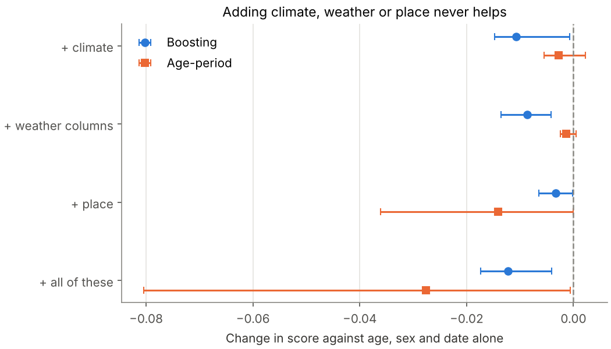
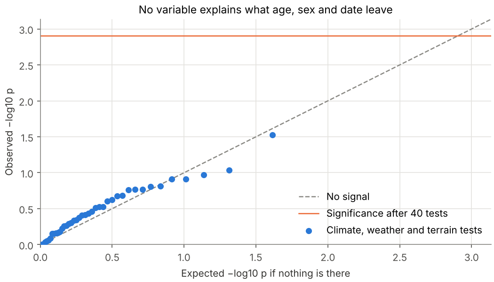
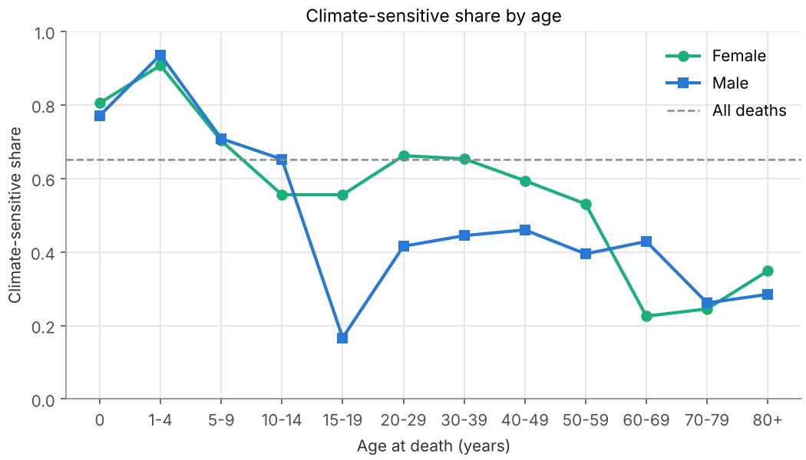
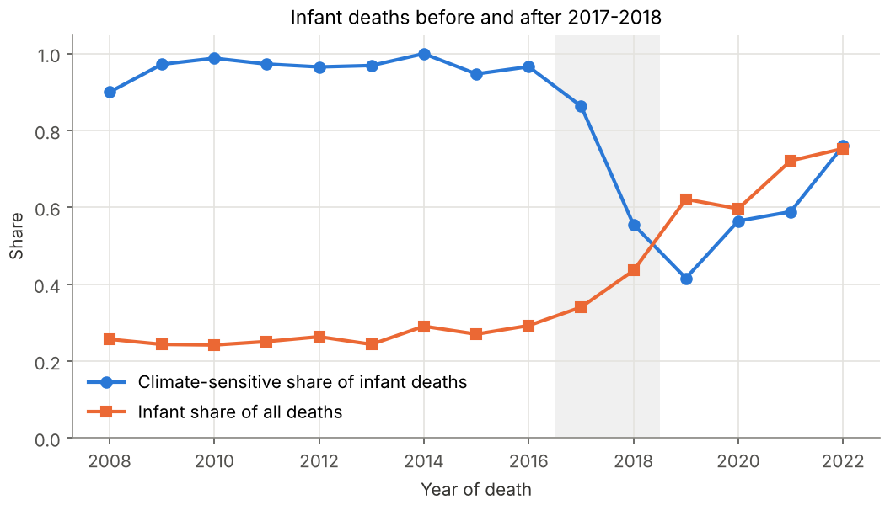
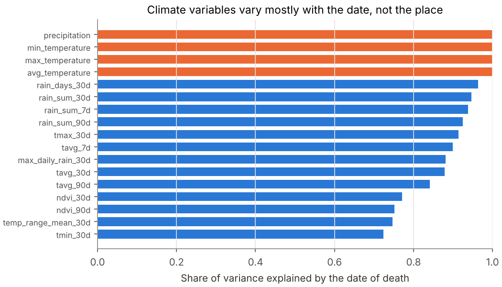
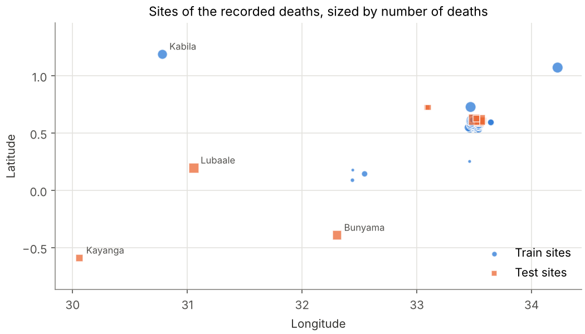
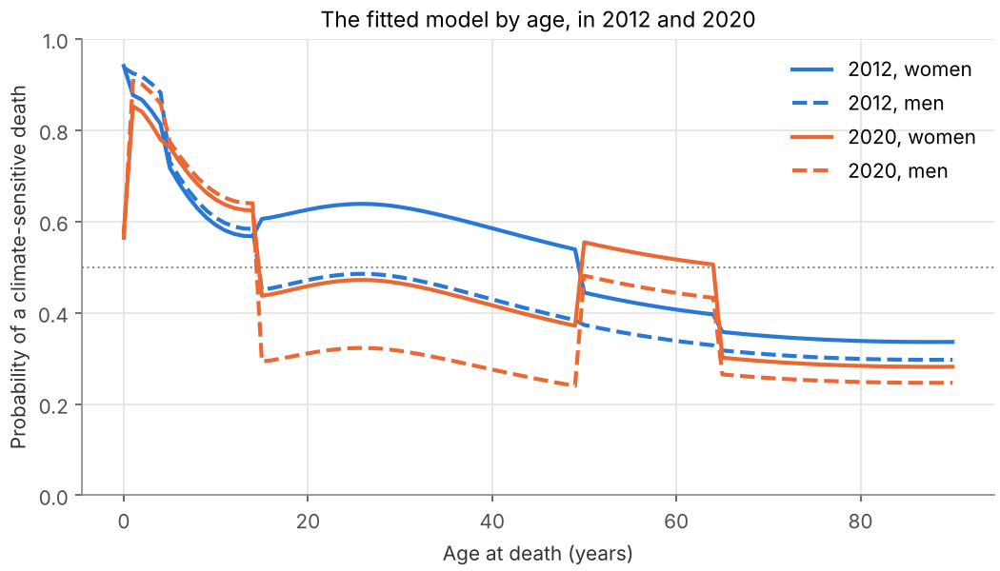
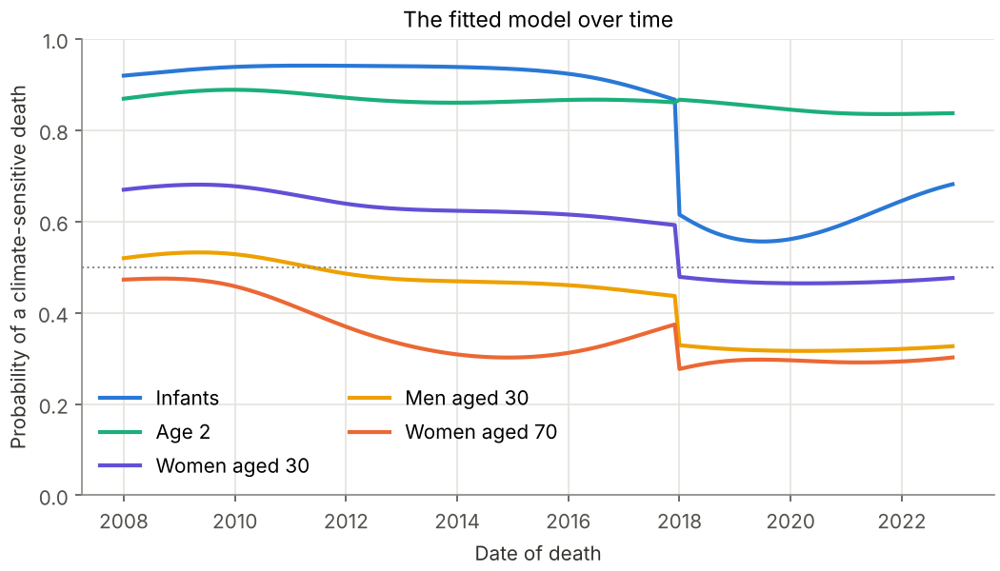

# Where Is the Climate?

**Climate data and climate-sensitive deaths in the Zindi Climate Risk and Health Prediction Challenge**

The [Zindi Climate Risk and Health Prediction Challenge](https://zindi.world/competitions/climate-risk-health-prediction-challenge) [1] asks whether a recorded death in eastern Uganda is climate-sensitive, and provides rainfall, temperature and vegetation data to help answer it. The question is well founded: climate has been linked to malaria deaths among children in malaria-endemic areas of Uganda [2], and heavy rainfall to a higher risk of malaria in eastern Uganda two to eight weeks later [3]. Yet in our experiments, none of the climate variables improved a model that knows only the age, sex and date of each death, and a model with no climate data at all gave our best cross-validated score. This repository explains why, and shows that the answer lies in what the label records, what the climate variables can describe, and how the test set was drawn.

In this dataset, three properties account for the result:

- **The label follows who died and when.** The share of climate-sensitive deaths depends strongly on age and sex, and among infants it falls from 95%–100% to 42%–59% within two years around 2017–2018, at the moment when infants grow from a quarter to most of the recorded deaths. A change this abrupt points to a change in how deaths were recorded rather than to the weather.
- **The climate variables describe when and where, not who.** Between 72% and 96% of the variance of each climate variable is shared by all deaths on the same date, and on 328 days, deaths that share exactly the same weather have different labels. Climate can only move the probability of all the deaths on the same day and place together, and no climate variable explains what age, sex and date leave unexplained.
- **The test deaths come from new places.** None of the 12 test sites appears in the training data, and 30% of the test deaths are placed 170–400 km from the centre of the surveillance area. With no difference between sites once age, sex and date are known, place-based variables add only noise.

<p align="center">
  
  
</p>
<p align="center"><em>Figure 1. Left: change in the challenge score when each group of variables is added to age, sex and date, with 95% intervals from resampling sites. Right: p-values of 40 tests of single climate, weather and terrain variables against what age, sex and date leave unexplained; they fall on the line expected when there is nothing to find. From <a href="2_why_climate_does_not_help.ipynb"><code>2_why_climate_does_not_help.ipynb</code></a>.</em></p>

## Table of Contents

- [The Challenge](#the-challenge)
- [How We Measured](#how-we-measured)
- [Findings](#findings)
- [What This Means for Climate-Health Prediction](#what-this-means-for-climate-health-prediction)
- [Notebooks](#notebooks)
- [Getting Started](#getting-started)
- [References](#references)
- [License](#license)

## The Challenge

Each record is a death in eastern Uganda between 2007 and 2022, with the age and sex of the person, the date of death, the village and its coordinates, four weather columns, and a label saying whether the death is climate-sensitive. The organisers also attached 13 climate variables computed over the 7 to 90 days before each death, from CHIRPS rainfall [5], ERA5-Land temperature [6] and MODIS vegetation [7], together with elevation and slope from SRTM [8]. The training set holds 3,146 labelled deaths, 65.1% of them climate-sensitive, and the test set 1,030.

The records come from the same area and years as the verbal-autopsy data of the Iganga–Mayuge Health and Demographic Surveillance Site released by Kiragga et al. [4], and appear to be drawn from it. The data dictionary defines the label only as whether a death is climate-sensitive, without listing the causes of death it includes.

Submissions are scored as 0.6 F1 plus 0.4 ROC-AUC, with the binary prediction taken at the fixed threshold of 0.5.

## How We Measured

**Validation.** Since the test deaths come from sites that never appear in the training data, every fold of our cross-validation holds out whole sites, a site being one pair of coordinates. We use 5 folds, balanced in class ratio, and repeat the split 10 times.

**Models.** Every comparison is run with two model families, so that a result does not depend on one model's way of using a variable. Both receive the age, sex and date of death, the date as years since 2007:

- **Boosting**: shallow, heavily regularised gradient-boosted trees, which can use any variable in any interaction.
- **Age-period**: a penalised logistic regression with smooth age and time effects, a time trend and a 2018 step for each of six age groups, and sex for each age group. Extra variables enter linearly.

**Comparisons.** A model with and without a group of variables is scored on the same folds, and the 95% interval of the difference resamples whole sites, so it reflects how the difference would vary on another set of villages.

**Single-variable tests.** To make sure that one useful variable is not hidden among useless ones, each variable is also tested alone. The age-period model's out-of-fold predictions enter a logistic regression as a fixed offset, and a likelihood-ratio test asks whether the variable explains anything that age, sex and date have not, either as one effect or as a separate effect in each age group.

## Findings

These findings describe the data of this challenge. They are not general claims about climate and mortality, or about other datasets.

### Climate data does not improve the predictions

Adding the climate variables, the weather columns or the place variables never improves either model (Figure 1, left). With the age-period model, the climate variables change the score by −0.003 and the weather columns by −0.001, both within noise. The boosted trees lose about 0.01 with either group, more than the noise, because every extra variable gives them another way to fit chance patterns in 3,146 deaths. Place variables do the most harm when they enter linearly, most likely because latitude and longitude then extrapolate to held-out sites far from the training ones. The best score of any combination, 0.8192, comes from age, sex and date alone.

The single-variable tests confirm that nothing is hidden in the groups (Figure 1, right). Their 40 p-values follow the line expected when there is nothing to find: the smallest, 0.03, is about what the smallest of 40 tests gives by chance, and far above the 0.0013 required once 40 tests are taken into account. The season shows no effect either (p = 0.42).

### The label follows who died and when

The climate-sensitive share is above 90% for children aged 1 to 4, falls through adolescence and is lowest after 60, with women's deaths more often climate-sensitive than men's between 15 and 59 (Figure 2, left). Age alone therefore separates most of the label, and the remaining structure is in time.

<p align="center">
  
  
</p>
<p align="center"><em>Figure 2. Left: climate-sensitive share of the training deaths by age, for women and men, with the share over all deaths as a dashed line. Right: climate-sensitive share of infant deaths and infant share of all recorded deaths by year, around the 2017–2018 change. From <a href="1_what_the_label_records.ipynb"><code>1_what_the_label_records.ipynb</code></a>.</em></p>

Among infants, the climate-sensitive share holds at 95% to 100% until 2016, then falls to between 42% and 59% from 2018 to 2021 (Figure 2, right). At the same moment the records change composition: infants go from about a quarter of all recorded deaths to 60%–75%, while fewer deaths are recorded at other ages. No other age group shows a comparable jump. A shift this abrupt, limited to infants and coinciding with a change in who is recorded, points to a change in how infant deaths were recorded or classified around 2017–2018 rather than to a change in climate, although the organisers have not described one. A model reads this change through the date of death.

### The climate variables describe when and where, not who

The four weather columns that come with each record have exactly one value per date: every death on a given day carries the same temperature and precipitation, wherever it happened. They are a single regional series, and for a model a code for the date. The downloaded climate variables are not much different. Between 72% and 96% of the variance of each one is shared by all deaths on the same date (Figure 3, left), and the calendar month alone explains 73% of the variance of 30-day rainfall. Since most deaths occur in a small area, the weather differs little from one village to the next, and these variables mostly record when a death happened, which the model already knows.

<p align="center">
  
  
</p>
<p align="center"><em>Figure 3. Left: share of each variable's variance explained by the date of death alone, for the weather columns (orange) and the downloaded climate variables (blue). Right: training and test sites, sized by number of deaths; three test sites lie far outside the surveillance area. From <a href="2_why_climate_does_not_help.ipynb"><code>2_why_climate_does_not_help.ipynb</code></a> and <a href="1_what_the_label_records.ipynb"><code>1_what_the_label_records.ipynb</code></a>.</em></p>

The date, however, cannot separate deaths that happen on the same day. On 328 of the 673 dates with two or more training deaths, some deaths are climate-sensitive and others are not, and the same holds for 23 of the 55 site-days with several deaths, where every climate variable is identical. A variable computed from the date and place of a death takes one value for all of them, so what separates them is who died. Climate can only move the probability of all the deaths on the same day and place together, and in this data that move is too small to measure.

Place cannot help either. None of the 12 test sites appears in the training data (Figure 3, right), so a variable that describes a place, such as its elevation, slope or usual climate, has never been seen with a label at any test site. Once age, sex and date are known, the training sites do not differ from one another (chi-squared 29.1 on 43 sites, p = 0.95), so there is no site effect for such variables to carry. Some coordinates are also wrong: 307 test deaths (30%) and 340 training deaths (11%) lie more than 60 km from the surveillance area, up to 400 km away, most likely at villages of the same name elsewhere in Uganda, and their climate values describe another place.

### A model of who died and when

Without any climate data, the age-period model scores 0.8192 in site-held-out cross-validation (F1 0.8150, ROC-AUC 0.8254), and [`3_climate_free_model.ipynb`](3_climate_free_model.ipynb) writes its predictions in the submission format. Its curves restate what the label tracks (Figure 4): a high probability for young children, a drop at adolescence and a low probability in old age, with women above men between 15 and 50, and a fall of about 25 points for infants at the start of 2018, larger than for any other group.

<p align="center">
  
  
</p>
<p align="center"><em>Figure 4. The age-period model fitted on all training deaths. Left: by age, for women and men in 2012 and 2020; the steps at 1, 5, 15, 50 and 65 years come from the age groups that carry the time and sex effects. Right: over time, for five ages. From <a href="3_climate_free_model.ipynb"><code>3_climate_free_model.ipynb</code></a>.</em></p>

## What This Means for Climate-Health Prediction

The links between climate and malaria reported for Uganda [2, 3] concern populations over time: whether more malaria cases or deaths follow particular weather. The challenge asks a different question: whether a particular death is climate-sensitive. A climate effect that raises the number of malaria deaths after the rains raises it for everyone exposed to the same rains, so it can change the expected share of climate-sensitive deaths on a given day, but it cannot say which of the deaths on that day is the climate-sensitive one. Reading individual outcomes from group-level associations is the classic ecological fallacy [9]. In this dataset, any group-level effect is too small to detect next to the influence of age, sex and the 2017–2018 change, and the individual-level information that could separate deaths on the same day, such as symptoms, age in days for infants or household conditions, is not in the data.

For anyone working on similar data, the results suggest three practical checks:

- **Look for what is constant within groups.** If a feature takes the same value for many records with different labels, it can only shift a group's average, and its ceiling is low before any model is trained.
- **Validate the way the test set was drawn.** Here, holding out whole sites is what reveals that place variables cannot transfer.
- **Test variables against the strongest simple model.** Climate variables correlate with the date, and the date carries a change in how deaths were recorded, so a variable can look useful only until age, sex and date are in the model.

The analysis has limits. It covers one dataset of about 3,000 labelled deaths, a label whose definition is not published, two model families, and the climate variables provided by the organisers. It shows that these variables do not help predict this label for individual deaths; it does not show that climate has no effect on mortality in this area, a question for population-level designs such as distributed lag models [10].

## Notebooks

| Notebook | What it covers |
| --- | --- |
| [`1_what_the_label_records.ipynb`](1_what_the_label_records.ipynb) | The sites, the weather columns, and the label by age, sex and year |
| [`2_why_climate_does_not_help.ipynb`](2_why_climate_does_not_help.ipynb) | Climate and the calendar, deaths on the same day, adding climate to two models, single-variable tests, site effects |
| [`3_climate_free_model.ipynb`](3_climate_free_model.ipynb) | The age-period model, its fitted curves and a submission file |

The code they share is in [`climate_health/`](climate_health): data loading, validation, the two models, the statistical tests and the plot style. The challenge data are in [`data/`](data).

## Getting Started

### Installation

You need Python 3.10 or later.

```sh
git clone https://github.com/YounesToukal/climate-features-vs-mortality.git
cd climate-features-vs-mortality
pip install -r requirements.txt
```

### Usage

The data are included, so the notebooks run as they are:

```sh
jupyter notebook
```

The tests run on simulated records:

```sh
python -m pytest tests
```

## References

1. Zindi. Climate Risk and Health Prediction Challenge. 2026. [zindi.world/competitions/climate-risk-health-prediction-challenge](https://zindi.world/competitions/climate-risk-health-prediction-challenge)
2. A. Kiragga, F. Otieno, B. Nabukeera, M. Ng'etich, Y. Tozan and D. Kajungu. Climate-driven malaria mortality among children in malaria-endemic areas of Uganda. *BMC Public Health*, 2025. [doi:10.1186/s12889-025-23678-0](https://doi.org/10.1186/s12889-025-23678-0)
3. Quantifying the lagged effects of climate variables on malaria risk in eastern Uganda. *American Journal of Tropical Medicine and Hygiene*, 2025. [doi:10.4269/ajtmh.25-0031](https://doi.org/10.4269/ajtmh.25-0031)
4. A. Kiragga, J. Todd, D. Kajungu, M. Wamukoya, A. C. Crampin and M. Urassa. Exploring climate and health pathways in the INSPIRE network. Harvard Dataverse, 2024. [doi:10.7910/DVN/DHDNIC](https://doi.org/10.7910/DVN/DHDNIC)
5. C. Funk et al. The climate hazards infrared precipitation with stations: a new environmental record for monitoring extremes. *Scientific Data*, 2, 2015.
6. J. Muñoz-Sabater et al. ERA5-Land: a state-of-the-art global reanalysis dataset for land applications. *Earth System Science Data*, 13, 2021.
7. K. Didan. MOD13Q1 MODIS/Terra vegetation indices 16-day L3 global 250m SIN grid V006. NASA EOSDIS Land Processes DAAC, 2015.
8. T. G. Farr et al. The Shuttle Radar Topography Mission. *Reviews of Geophysics*, 45(2), 2007.
9. W. S. Robinson. Ecological correlations and the behavior of individuals. *American Sociological Review*, 15(3), 1950.
10. A. Gasparrini, B. Armstrong and M. G. Kenward. Distributed lag non-linear models. *Statistics in Medicine*, 29(21), 2010.

## License

The code is distributed under the MIT License. See [`LICENSE`](LICENSE) for more information. The challenge data in [`data/`](data) are distributed by Zindi under the [CC BY-SA 4.0](https://creativecommons.org/licenses/by-sa/4.0/) licence.
